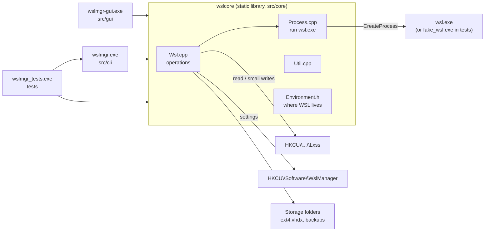

# WSL Manager: design

This document covers how WSL Manager is put together and why. It's for anyone changing the code. For build and usage instructions, see the [README](../README.md).

## Goals

WSL Manager manages WSL instances on one Windows machine, for the current user:

- create an instance from a clean install, from a backup, or as a copy of another instance, in a storage folder you choose;
- back up and remove instances;
- move an instance's storage to another folder;
- handle smaller tasks: rename, set the default instance or default user, stop, shut down, and open a shell.

It deliberately leaves out editing `.wslconfig`, managing distribution packages, and anything that needs administrator rights.

## Architecture

The code has three layers, and each depends only on the layer below it:

| Layer | Files | Responsibility |
|---|---|---|
| **Core** | `src/core/` | All WSL logic. It has no UI code. Every operation is a blocking function that throws `WslError` and reports progress through an `OutputFn` callback. |
| **CLI** | `src/cli/Cli.cpp`, `main.cpp` | Parses arguments, confirms risky actions, and prints output. `RunCli()` lives in a library so the tests can call it directly. |
| **GUI** | `src/gui/` | A Win32 window with a list view, a log pane and modal dialogs. It runs core operations on worker threads. |

Both front ends are thin. Anything that both need, such as default backup paths, name validation or format handling, belongs in the core.

## How WSL is driven

WSL has no public API covering these operations, and `wslapi.dll` only exposes registration and launching. WSL Manager therefore uses two channels:

1. **`wsl.exe` for every state-changing operation**, such as install, import, export, unregister, move and terminate. WSL keeps responsibility for its own consistency: the VM, disk attachment and the service's caches.
2. **The registry for reading**, under `HKCU\Software\Microsoft\Windows\CurrentVersion\Lxss\{GUID}`. `wsl -l -v` doesn't report storage paths, disk files or default users, and its output is localised. The registry is fast, structured and the same in every language.

| Operation | Mechanism |
|---|---|
| List instances | Registry enumeration, plus `wsl --list --running --quiet` for running state |
| Installable distributions | `wsl --list --online`, parsed from the `NAME  FRIENDLY NAME` table |
| Clean install | `wsl --install <distro> --name <n> --location <dir> --no-launch --version <v> [--web-download]` |
| Restore a backup | `wsl --import <n> <dir> <file> (--vhd \| --version <v>)` |
| Copy an instance | `wsl --import <n> <dir> <source ext4.vhdx> --vhd`, falling back to export then import (see below) |
| Backup | `wsl --export <n> <file> --format vhd\|tar\|tar.gz\|tar.xz` |
| Remove | `wsl --unregister <n>` |
| Move storage | `wsl --manage <n> --move <dir>` |
| Set default user | `wsl --manage <n> --set-default-user <user>` |
| Set default, stop, shut down | `--set-default`, `--terminate`, `--shutdown` |
| Open a shell | `wsl --distribution <n> --cd ~` in a new console |
| **Rename** | Writes `DistributionName` directly, because `wsl.exe` has no rename command |
| **Restore details after an import** | Writes `DefaultUid`, `Flavor` and `OsVersion` directly |

The registry fields WSL Manager reads are `DistributionName`, `BasePath` (which may carry a `\\?\` prefix), `Flags` (bit `0x8` means WSL 2), `DefaultUid`, `State`, `VhdFileName`, `Flavor` and `OsVersion`, plus `DefaultDistribution` on the `Lxss` key itself. Direct writes happen only while the instance is stopped.

`wsl.exe` writes UTF-16 by default. `RunProcess` sets `WSL_UTF8=1` so it writes UTF-8 instead. The line splitter also drops NUL bytes, in case some build ignores that variable.

## Key decisions

### Copy by importing the source's disk
For WSL 2, a copy imports the source's own `ext4.vhdx` with `--import --vhd`, which copies the disk once. Exporting to a temporary file and importing that would copy the data twice. If the direct import fails, the copy falls back to export then import, using a temporary file inside the target folder. That temporary file is deleted on success and on failure. WSL 1 instances always go through a tar export.

### Wait for WSL to release the disk
On WSL 2.6, `wsl --terminate` returns before the VM detaches the instance's disk. The disk stays locked until the VM goes idle, which took about 40 seconds in testing. Calling `--manage --move` immediately failed with `ERROR_SHARING_VIOLATION`. Before moving or copying a disk, `WaitForDiskRelease` polls by opening the file exclusively. The default timeout is 2 minutes and the poll interval is 2 seconds, both set in `Environment`. It reports progress while it waits. If the timeout passes, it suggests shutting down WSL, but it never shuts down WSL on its own, because that would stop every instance.

### Backup metadata file
`wsl --import` registers a bare instance that logs in as root. Each backup therefore gets a small UTF-8 `key=value` file saved alongside it as `<backup>.wslmeta`. It records the name, WSL version, default UID, flavor, OS version, format and creation time. A restore applies the UID, flavor and OS version from it if the file exists. Backups made by other tools still restore, just without those details.

### Storage folder rules
`PrepareTargetFolder` accepts a folder only if:
- it isn't a file;
- no other instance uses it as its `BasePath`;
- it doesn't already contain an `ext4.vhdx`.

The folder is created if needed. If the operation then fails, the folder is removed again, but only if it's empty. Folders are never deleted recursively. Some instances share a parent folder (for example `D:\WSL` holding one instance directly and others in subfolders), and an empty-only delete can't remove anyone else's data.

### Protected instances
Some instances belong to other software. The main case is `docker-desktop`: Docker Desktop creates it, and stopping, moving or removing it behind Docker's back breaks Docker. Any instance can be marked **protected**, and while it is, the core refuses these operations:
- remove, move or rename it
- stop it
- make it the default instance
- change its default user
- back it up or copy it, because both stop it

Each of these goes through `RequireUnprotected`, which throws before any `wsl.exe` command runs. Its message names the blocked action and explains how to unprotect the instance. Opening a shell, listing and `Shutdown` (a global action) are still allowed.

- **Storage:** protection is a DWORD per instance *name* under `HKCU\Software\WslManager\Protected`: 1 means protected, 0 means explicitly unprotected. With no value, the defaults apply. `docker-desktop` and `docker-desktop-data` are protected by default, so they're safe even before the user has opened WSL Manager. Keying by name rather than GUID means the setting survives Docker Desktop recreating its instance.
- **Removal:** removing an instance deletes its value, so a later instance with the same name starts from the defaults. Renaming a protected instance is itself blocked, so a name-keyed setting can never end up pointing at the wrong instance.
- **The two front ends:** both enforce protection through the core, and both explain it up front. The GUI greys out blocked commands for a protected selection, and leaves protected instances out of the "copy an existing instance" list. Unprotecting asks for confirmation, with an extra warning for Docker's instances. The CLI shows protection in `list` and `info`.

### Stopping instances
Operations that need an instance stopped (backup, copy, move, rename and remove) stop it themselves. Each front end asks first if the instance is running: the GUI shows a dialog, and the CLI shows a `[y/N]` prompt, which `--yes` skips. A prompt the CLI can't answer counts as no.

### Process handling
`RunProcess` passes the child exactly two inheritable handles: `NUL` for stdin and one pipe for stdout and stderr. It uses `PROC_THREAD_ATTRIBUTE_HANDLE_LIST` for this. Without the list, a refresh and an operation running at the same time on different GUI threads could leak each other's pipe ends, and a read would hang until the *other* child exited. A line ending in a bare `\r` is reported as a progress line, which is how `wsl.exe` redraws its progress. The GUI shows these lines in the status bar and the CLI redraws them in place. Neither adds them to the log.

### Build choices
- The C runtime is linked statically (`/MT`), so the executables run without the VC++ redistributable.
- Core headers are included as `core/...`, not by adding `src/core` to the include path. Windows paths are case-insensitive, so `src/core/Process.h` would otherwise shadow the CRT's `<process.h>`.
- The GUI manifest declares Common Controls v6, PerMonitorV2 DPI awareness and `asInvoker`. Nothing needs elevation.

## Installer

`installer/Package.wxs` defines a **per-user** MSI, built with WiX Toolset 5 by `package.cmd`. Per-user suits the app: it only manages the current user's WSL instances, so it never needs elevation, and neither does its installer.

- **Install location:** `%LOCALAPPDATA%\Programs\WSL Manager`. This is the conventional per-user programs folder, and it doesn't vary with `ALLUSERS`. That's why WiX reports ICE91 warnings, which are expected and harmless here.
- **Start menu shortcut:** one shortcut, for the GUI, in the user's Start menu.
- **PATH:** an `Environment` entry appends the install folder to the user's `PATH` (`HKCU\Environment`). Windows Installer removes it again on uninstall.
- **Key paths:** files under the user profile can't be component key paths. Each component therefore uses a value under `HKCU\Software\WslManager\Installer`, and the folders it creates have matching `RemoveFolder` entries. Uninstalling removes only the `Installer` subkey. The user's `DefaultRoot` setting in the parent key is deliberately left in place.
- **Fixed IDs:** the `UpgradeCode` and the two file components' GUIDs are fixed. WiX can't derive GUIDs for components whose key path is a registry value. **Never change them.** With `MajorUpgrade`, installing any version replaces the installed one, and installing an older version over a newer one is refused.
- **Setup pages:** Welcome → Licence → Ready to install → progress → Finished. These come from WiX's `WixUI_InstallDir` dialog set, with two `Publish` overrides that skip the folder-choice page, because a per-user tool belongs in the standard folder. The Licence page shows `installer/License.rtf`, and Next stays disabled until the box is ticked. A silent install (`msiexec /qn`) skips the pages, as usual for MSIs.
- **Licence text:** `License.rtf` is generated from `LICENSE` by `installer/make-license-rtf.ps1` and committed. The script rejoins `LICENSE`'s hard-wrapped lines into paragraphs so the text reflows in the narrow licence box. If `LICENSE` ever changes, rerun the script.
- **Version:** CMake writes `project(VERSION)` to `version.txt` in the build folder, and `package.cmd` passes it to WiX. The MSI version can't drift from the build.
- **WiX version:** the project pins WiX **5.0.2** and its UI extension (`WixToolset.UI.wixext`, the same version) as a repo-local dotnet tool. `package.cmd` caches the extension in `.wix/`, which is git-ignored. WiX 6 and later require accepting the Open Source Maintenance Fee terms. Moving to them is a licensing decision, not just a version bump.

The installer was checked by hand: silent install, then upgrading 1.0.0 to 1.0.1, then uninstall. It installed with no elevation, left one registered product and one PATH entry after the upgrade, and on uninstall restored the original `PATH` exactly and kept the user's setting.

## GUI threading model

- The UI thread never calls `wsl.exe`.
- `RunOperation()` disables the commands, then runs the work on a detached `std::thread`.
- The worker reports back with `PostMessage`. Output lines arrive as `WM_APP_OUTPUT` and completion or failure as `WM_APP_DONE`. Each message carries a heap-allocated string that the UI thread frees.
- If `PostMessage` fails because the window is gone, the worker frees the data itself.
- Refreshing the list runs on its own background thread (`WM_APP_LIST`). A refresh requested while one is already running is queued, not run in parallel.
- Only one operation runs at a time. While it runs, only Refresh, Open Shell and Open Folder stay enabled.
- Closing the window during an operation asks for confirmation. If you close anyway, `wsl.exe` keeps working, but you won't see the result.

## Error handling

- The core throws `WslError` with a message ready to show to the user. When `wsl.exe` fails, the message is `wsl.exe <command> failed:` followed by its own output. If it printed nothing, the exit code is shown in hex.
- Win32 failures go through `ThrowLastError` and get the system's message text.
- Filesystem calls use `std::error_code` overloads, so no `filesystem_error` escapes.
- The CLI prints `error: <message>` and exits with code 1.
- The GUI logs the failure and shows a message box.

## Testing

The test suite (`tests/`, GoogleTest) runs the real core and CLI code against a simulated WSL:

- **`Environment`** (`src/core/Environment.h`) is the only test seam. It sets the path to `wsl.exe`, the Lxss and settings registry keys, and the disk-release timings. Before any test runs, the test `main` points it at `fake_wsl.exe` and at a key with no instances, so no test can reach the real WSL by accident.
- **`fake_wsl.exe`** (`tests/fake_wsl/`) implements the `wsl.exe` commands listed above against a scratch `HKCU\Software\WslManagerTests\<pid>-<n>` key and scratch folders. It creates and moves `ext4.vhdx` files and writes export files. It also logs every invocation so tests can check the exact command lines. Environment variables control injected failures, silent failures, UTF-16 output, progress lines, instances that don't register, and catalog variants. They're documented at the top of the source file.
- **`WslTest`** gives each test a fresh registry key and temp folder and removes both afterwards. Its helpers register instances directly, run the CLI in-process with redirected standard handles, and read the fake's call log.
- **`ConsoleScope`** covers the CLI's console-only paths: `WriteConsoleW`, redrawing progress and keyboard prompts. It points stdout and stderr at a hidden console screen buffer that the test reads back, and queues keystrokes into the console's input.
- **Disk-lock tests** hold the disk file open exclusively, either releasing it from a second thread or never releasing it, to exercise `WaitForDiskRelease`.

**Coverage.** `test.cmd --coverage` rebuilds the core, CLI and tests with `clang-cl` and Clang's source-based coverage. It then runs the tests and reports line, region and branch coverage for `src/core` and `src/cli` with `llvm-cov`. MSVC has no free native coverage tool: `dotnet-coverage` only instruments native binaries in Visual Studio Enterprise, and the old `CodeCoverage.exe` no longer collects.

The coverage target is 100% of the core and CLI. At the time of writing (110 tests), 100% of functions are covered, 99.7% of lines and 99.2% of branches. `Wsl.cpp` and `Util.cpp` are fully covered. The only gaps are defensive handlers for failures that tests can't produce without fault injection in production code:

| Where | Uncovered | Why it stays |
|---|---|---|
| `Process.cpp` | `CreatePipe`, `InitializeProcThreadAttributeList` and `UpdateProcThreadAttribute` failing, and `CreateFileW("NUL")` returning `INVALID_HANDLE_VALUE` | These Win32 calls fail only when the system is out of resources |
| `Cli.cpp` | `catch (const std::exception&)` in `RunCli` | Nothing in the CLI throws anything except `WslError`. The handler stops an unexpected `bad_alloc` from crashing the program with an unhandled exception |

Keep it this way. A new branch in the core or CLI should come with a test, or with an entry in this table explaining why it can't have one.

The GUI (`src/gui`) is outside the automated tests and the coverage target. Most of its code is Win32 message handling and modal dialogs, including shell file pickers, which need UI automation to drive. Its logic is limited to argument assembly, and the core functions it calls are tested.

## Limitations and future work

- **Localisation.** The catalog parser looks for the English `NAME`/`FRIENDLY NAME` header. On a non-English system, the clean-install list may come back empty. Listing installed instances isn't affected, because it reads the registry.
- **Rename leaves old names behind.** Start menu shortcuts and Windows Terminal profiles that WSL generated keep the old name.
- **No cancellation.** A running `wsl.exe` operation can't be cancelled from the GUI.
- **No GUI tests.** UI Automation tests could cover the GUI.
- **Legacy Store installs.** Older Microsoft Store packages may not register until first launch. The core reports this rather than treating it as a failure.
